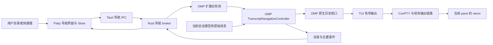
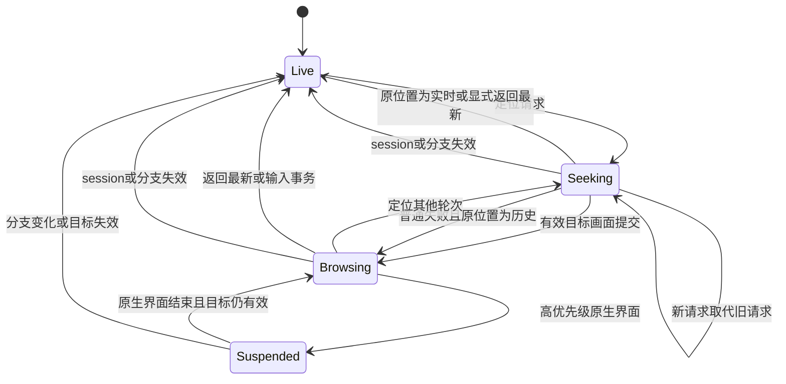

# OMP 同一会话轮次快速跳转实现方案

| 项目 | 内容 |
| --- | --- |
| 文档日期 | 2026-11-05，Asia/Shanghai |
| 状态 | 2026-11-06 已获授权并进入实施，渐进高亮决策见第 24 节 |
| 目标项目 | Patty，`D:\code\terminal\terminal-sidebar` |
| 配套项目 | Oh My Pi，以下简称 OMP |
| 已检查的 OMP 版本 | 本机 `@oh-my-pi/pi-coding-agent 18.13.3` 及其配套 `pi-tui` 源码 |
| 当前授权范围 | 用户已授权按方案实施，保留本机全局 OMP 安装 |
| 配套实现 | 固定 OMP 18.13.3，隔离源码和运行时，补丁与验证脚本随项目保存 |

本文规定用户行为、模块职责、协议、状态机、实现顺序及验收方法。文中的新模块、接口、协议字段和性能指标均为拟定设计，不代表当前软件已经具备这些能力。

2026-11-08 更新：产品路径已切换为普通 OMP 18.17.0 通过 Patty 的 OMP 扩展接入。本文关于 18.13.3 companion 的内容保留为历史设计记录；当前实施状态见 [实施状态](D:/code/terminal/terminal-sidebar/docs/plan/omp-navigation-progress.md)。

## 1. 结论与需求边界

实现“当前会话的对话目录”。用户点击某次提问，或执行上一轮、下一轮命令后，当前终端直接呈现对应轮次的位置。

完整方案由两部分组成：

1. Patty 提供轮次目录、搜索、快捷键、终端实例绑定和定位请求。
2. OMP 提供按消息 ID 定位的原生终端历史视口，复用现有消息渲染器。

历史内容始终显示在用户当前使用的终端 pane 中。目录不承载另一份聊天正文。

需要明确实际机制：定位任意历史时，OMP 在同一终端进入历史显示状态，使用由现有 TUI 管理的 fullscreen overlay 和 alternate screen 呈现目标内容。退出后回到实时终端界面。它复用原有内容与渲染器，但会按当前终端宽度重新排版，不保证复原消息最初出现时的像素、物理行号或选区。

这个机制能覆盖已经离开 xterm scrollback 的内容。单纯调用 `scrollToLine()` 无法实现这一点。

如果产品要求进一步收紧为“只能滚动已经存在的物理 scrollback，不能重新呈现内容”，那么已被淘汰的行没有可定位对象，无法同时保证任意历史可跳转。该限制必须在实施前明确，不能用增加 scrollback 上限掩盖。

## 2. 需求说明

### 2.1 使用场景

用户在同一 OMP session 中持续工作。每轮回复可能含有很长的思考内容、代码和工具输出，使相邻用户提问之间相隔数百甚至数千行。用户希望直接选择某轮，查看那次提问及其后续回复，而不必反复滚动查找。

### 2.2 目标

- 为当前 OMP session 的当前分支建立准确的用户提问目录。
- 点击目录项后，在当前终端显示该轮提问的开头。
- 支持上一轮、下一轮、回到最新和按提问摘要搜索。
- 已离开终端滚动缓存的消息仍能定位。
- 浏览期间，Agent 可以继续生成和执行工具，当前阅读位置保持稳定。
- 导航只改变显示位置，不回退会话、不切换模型上下文、不重复提交用户请求。
- 返回最新时恢复输入草稿、焦点和正确的实时输出。
- 分屏、会话恢复和分支切换时不发生消息或终端串线。

### 2.3 非目标

- 不为其他 Agent 同时实现适配器。
- 不在 Patty 中重写 OMP 的消息正文渲染器。
- 不使用 `/tree`、`navigateTree`、fork 或恢复旧 leaf 实现浏览。
- 不通过向 PTY 写命令、模拟按键或修改用户输入实现导航控制。
- 不增加模型生成的历史摘要。
- 不实现跨 session 全文检索。
- 不恢复已经被用户删除、损坏或永久移除的消息正文。
- 不为所有终端程序增加磁盘支持的虚拟 scrollback。
- 不把本机 OMP 安装目录作为正式开发工作区直接修改。

### 2.4 首批部署范围

首批实现和验收使用 Patty 已具备身份校验的本地 Windows OMP 接入。协议不依赖 Windows 路径，便于后续扩展，但本次不宣称 WSL、SSH 或容器中的 OMP 已获支持。

远程支持需要单独解决通信可达性、进程归属和会话生命周期验证。不能仅将 loopback 地址替换为远程地址后启用。

### 2.5 核心验收条件

| 编号 | 条件 |
| --- | --- |
| AC-01 | 每个符合轮次定义的用户输入对应一个稳定目录项 |
| AC-02 | 点击目录项后，当前终端可见区显示该轮提问起点 |
| AC-03 | 最早一轮已超出 scrollback 上限时，仍满足 AC-02 |
| AC-04 | 导航操作不调用会话回退、分支切换或用户请求提交接口 |
| AC-05 | 后台持续生成时，历史画面不自动回到底部 |
| AC-06 | 返回最新后，输出不重复、不丢失，输入草稿和焦点恢复 |
| AC-07 | 连续选择不同轮次时，最后一个有效请求决定最终位置 |
| AC-08 | resize、字体变化和显示设置变化后，阅读位置仍指向对应内容 |
| AC-09 | 分支、session、PTY 或 OMP 实例变化后，旧请求不能覆盖新实例 |
| AC-10 | 旧版 OMP 没有声明所需能力时，明确显示不可用原因 |
| AC-11 | 单条消息、单个代码块和单个工具输出很长时，导航仍有界处理 |
| AC-12 | 完成证据来自实际终端显示，不能只依据 HTTP 应答或 OMP flush |

## 3. 已核实事实与待新增能力

### 3.1 Patty 现状

| 已核实事实 | 对设计的约束 |
| --- | --- |
| Patty 使用 Tauri、Rust、React 和 xterm.js | 目录属于 React，进程绑定属于 Rust，正文显示仍由 OMP 输出到 xterm |
| 已有 `resources/omp-patty-hook.ts` | 可以扩展既有适配器，不必另装一个互相独立的 OMP 插件 |
| OMP adapter 当前只上报生命周期状态，未提供完整轮次数据 | 不能直接用现有工作状态事件推算轮次 |
| Hook 服务绑定随机 loopback 端口，有四个同步请求 worker | 长轮询不能在这些 worker 中直接等待 |
| 现有 `/hook` 正文上限为 16 KiB | 新目录协议必须分批，不得直接塞入整份会话 |
| 现有 Hook 包含 secret、进程身份和 PTY 归属校验 | 新控制通道应复用身份判断，不建立只凭 paneId 的入口 |
| 现有 origin 可包含 conversationId，但 OMP adapter 尚未传入 | 新适配器必须实际填充真实 OMP session 身份 |
| xterm 实例由 `TerminalPane` 私有持有 | 不应把整个 xterm 实例放进全局 Store 或传到协议层 |
| PTY 输出经过调度后才写入并由 callback 确认 | HTTP 事件到达时间不等于相应内容的屏幕位置 |
| scrollback 有限，重启不恢复终端历史 | 不得用当前 buffer 代表完整 OMP 会话 |
| 现有 PTY replay 不是完整历史归档 | 不能利用它恢复任意已经交付的旧内容 |
| 已有命令面板、快捷键和焦点恢复逻辑 | 新入口接入现有系统，避免另建全局键盘处理链 |

关键本地源码：

- [OMP 适配器](D:/code/terminal/terminal-sidebar/resources/omp-patty-hook.ts)
- [Hook 协议](D:/code/terminal/terminal-sidebar/resources/hook-protocol.json)
- [Hook 服务](D:/code/terminal/terminal-sidebar/src-tauri/src/hooks.rs)
- [Hook 身份](D:/code/terminal/terminal-sidebar/src-tauri/src/hook_identity.rs)
- [PTY 输出](D:/code/terminal/terminal-sidebar/src-tauri/src/pty_output.rs)
- [终端组件](D:/code/terminal/terminal-sidebar/src/renderer/components/Terminal/TerminalPane.tsx)
- [前端 API](D:/code/terminal/terminal-sidebar/src/renderer/api.ts)
- [键盘与焦点处理](D:/code/terminal/terminal-sidebar/src/renderer/commands/useApplicationKeyboard.ts)

### 3.2 OMP 18.13.3 现状

| 已核实事实 | 对设计的约束 |
| --- | --- |
| 主对话将稳定内容写入 normal buffer，尾部保留可变 viewport | 浏览必须与现有历史批次及实时绘制调度协调 |
| fullscreen overlay 使用 alternate buffer | 可以作为原生历史视口的接入基础，但不是已有完整导航功能 |
| session message entry 包含 id、parentId、timestamp 和 message | 当前分支必须按父链确定，不能直接按 JSONL 文件行序排列 |
| 只读 session manager 提供 session、leaf、branch 和 entries 访问 | 目录来源可由 OMP 内部提供，Patty 不必猜测文件位置 |
| 用户消息 renderer 输出 OSC 133 边界 | 证明有终端边界接入，但标记不带 entryId，不能独立覆盖全部导航 |
| emergency 单行展示会省略部分 OSC 133 标记 | 不能假设每次用户消息展示都有可供宿主使用的边界 |
| 消息与组件已有 WeakMap 关联，但不是完整稳定 entryId 管线 | 需要贯通持久消息、展示条目、组件和定位索引 |
| `getChildStartRow()` 对应最近一次完整语义渲染 | 它不是实时 xterm scrollback 行号 |
| 恢复展示会考虑压缩历史折叠与进行中的工具调用 | 原始消息存在不等于当前 renderer 已直接提供其显示组件 |
| `navigateTree` 会改变会话上下文 | 禁止用作浏览 API |
| 当前公开扩展 API 没有完整的 `seekEntry` 能力 | 必须修改 OMP core，不能只写 Patty adapter 就宣称完成 |

### 3.3 本方案明确新增的能力

- OMP 原生逻辑历史视口。
- 稳定消息身份贯穿原生渲染路径。
- 支持范围布局的消息渲染适配层。
- 超长代码块、工具结果和思考块内部的行级窗口化。
- 只读显示定位、返回实时和位置通知 API。
- Patty 与 OMP 扩展之间的受信双向控制通道。
- 分页目录快照和版本化增量。
- 可观测的目标画面完成信号及实际 xterm 验收。

以上能力均需实现和验证。

## 4. 方案选择与取舍

| 候选 | 可覆盖范围 | 主要问题 | 决定 |
| --- | --- | --- | --- |
| 现有 OSC 边界与 xterm marker | 当前 buffer 内可确认位置的内容 | 缺少 entryId，重绘需更新，淘汰后不可访问 | 不作为首版主路径 |
| 新增带 entryId 的物理锚点 | 当前 buffer 中的语义消息 | 仍无法访问已被淘汰的内容 | 保留为未来优化，不影响完整性 |
| OMP 原生逻辑历史视口 | 当前分支中仍可读取的消息记录 | 需要 OMP core 配套改动 | 采用 |
| Patty 磁盘虚拟 scrollback | 宿主保存过的终端历史 | VT 状态、重排、图片和重放成本高，还缺消息语义 | 不采用 |
| 独立聊天正文阅读面板 | 可读取的结构化消息 | 改变了本次要求的终端内跳转体验 | 不采用 |

“锚点失效后重新打印整轮”也不足以独立解决问题。某轮本身可能超过 scrollback 上限，打印完成时它的提问再次被淘汰。若只绘制目标附近并按滚动加载，实际就需要逻辑历史视口。

接受的取舍是维护一个 OMP 原生历史显示状态，换取对全会话历史的定位能力。正文继续使用原渲染器，不在 Patty 中复制一套 Markdown 或工具结果呈现逻辑。

## 5. 用户交互

### 5.1 目录入口

- 通过命令面板打开“当前会话对话目录”。
- 当前终端提供一个按需显示的目录入口，不增加永久正文区域。
- 目录跟随当前聚焦的终端 pane，而不是只跟随侧栏选中名称。
- 不支持导航的终端显示明确原因。
- 首版将快捷键作为可配置命令接入。默认组合在实际 OMP 和 Windows 环境验证冲突后确定，不在文档中假定某组合一定空闲。

目录项包括当前分支中的轮次序号、提问摘要和时间。摘要由原文截取，不调用模型。附件独立成轮且没有可用文本时，显示确定的占位文字，例如“图片提问”或“附件提问”。

### 5.2 点击与键盘行为

| 操作 | 行为 |
| --- | --- |
| 点击目录项 | 向该 pane 当前 OMP 实例发送绝对 entryId 定位请求 |
| 上一轮 | 根据 OMP 实际阅读位置选择前一轮 |
| 下一轮 | 根据 OMP 实际阅读位置选择后一轮 |
| 回到最新 | 取消过时定位并恢复实时终端 |
| 目录搜索 | 搜索提问摘要，不搜索思考或工具输出 |
| 目录内 Esc | 清除当前搜索或关闭目录，遵循现有交互优先级 |
| 终端历史状态下 Esc | 返回实时终端 |
| 关闭目录 | 保留已生效的阅读位置，不强制返回最新 |
| 切换到其他 pane | 保留原 pane 的阅读位置，取消不再适用的前端待执行控制 |

目录的“当前项”由 OMP 上报的实际阅读位置决定。点击后可以先显示请求中状态，但不能立即把成功状态写入 Store。

上一轮和下一轮在发往 OMP 前必须解析成绝对 entryId。网络重试不能重复执行“再上一轮”这样的相对操作。

连续操作还需维护独立的意图位置。没有待执行导航时，相对操作从 OMP 已显示位置计算；有待执行导航时，从最新意图目标累进计算。例如尚未完成从第 10 轮跳到第 9 轮时，再按一次上一轮应产生第 8 轮目标。意图位置不能覆盖实际显示位置，失败后根据当前实际位置重新建立基准。

### 5.3 新输出与输入

浏览期间的新消息更新“有新输出”提示和目录，但不移动历史视口。运行状态和显示状态分开管理，例如 generating 与 browsing 可以同时成立。

用户输入文字或粘贴时，OMP 以一次事务完成：

1. 捕获完整输入事件。
2. 验证当前 run、session 和显示控制代际，并提高本地 displayEpoch。
3. 返回实时界面并恢复编辑器草稿。
4. 再次确认目标 session 未变。
5. 将原输入交给编辑器一次。

bracketed paste 必须作为整次粘贴处理。不能逐字符返回实时，也不能先清空草稿。

输入法合成期间不把未提交字符解释成导航快捷键。需用真实中文输入法验证提交文本不重复、不丢失。

displayEpoch 是 OMP UI 线程维护的本地输入屏障。它在处理输入前立即提高，不等待网络。所有远程命令都携带 broker 已知的预期 displayEpoch，因此输入前已发出、仍在 poll 途中的 seek 也会在 OMP 侧失效。OMP 随后上报新 epoch，broker 作废旧请求。客户端遇到 stale_display 时刷新位置，不自动重放可能违背本地输入意图的旧导航。

`Ctrl+C` 保留现有语义：有终端选区时复制，没有选区时按原有 OMP 中断规则处理。历史模式不得吞掉用户明确的中断操作。

### 5.4 审批和其他原生界面

历史视口必须纳入现有 TUI 界面所有权，不自行嵌套启用 alternate screen。

审批、输入问题和其他高优先级 modal 出现时：

1. 暂停历史交互，保存逻辑阅读锚点。
2. 通过现有 TUI 调度交出界面所有权。
3. modal 关闭后，验证 session 和 branchEpoch。
4. 目标仍有效时恢复阅读位置，否则返回实时并说明原因。

modal 期间的输入不能在关闭后重放给编辑器。未完成的定位请求返回 busy 或被明确取代，不能静默遮挡审批界面。

### 5.5 选择和复制

备用屏幕没有原生 scrollback。首版明确支持当前可见区域的终端选择复制，并增加“复制这一轮原文”操作，由 OMP 从消息记录生成文本。

“复制这一轮原文”复制该轮用户消息和回复的文本内容，采用固定的消息分隔格式。思考和工具结果是否包含由明确选项决定，不因当前屏幕折叠状态发生隐式变化。

任意跨虚拟页面拖选不作为首版承诺。若后续实现，必须保存源文本逻辑选区，并在翻页和 resize 后保持。不能声称 xterm 单屏选区天然支持跨页。

该限制须在交互验收中记录，不得用“完全沿用原来的复制体验”概括。

## 6. 架构与职责



### 6.1 OMP 持有正文与显示真相

OMP 负责当前分支、消息身份、生成中内容、布局、浏览位置和输入事务。Patty 不另行解析 JSONL 作为并行正文来源，也不从屏幕文字猜测用户消息。

已落盘历史和正在生成的内容由 OMP 会话模型合并。尚未形成持久 entryId 的临时内容可以显示，但不能伪造稳定目录 ID。

### 6.2 Rust 持有绑定与传输真相

新增 `omp_navigation` 模块集中管理：

- 已验证的 OMP 实例及能力。
- lease 及其撤销。
- 目录快照和增量版本。
- 定位请求、交付、取消和终态。
- 前端订阅快照。

`hooks.rs` 只负责接入、解析和转交，不承载完整导航状态机。

现有 Agent 状态与导航协议保持独立。不得把目录消息塞进原有闭集状态事件词汇，也不能让浏览行为点亮 Working 或清除审批状态。

### 6.3 React 持有交互状态

前端 Store 负责目录查询、当前控制目标、等待状态和实际位置投影。正文不进入该 Store。

命令系统决定 focused pane 并调用导航 API。`TerminalPane` 只配合当前实例的焦点、显示完成验证和必要屏幕恢复，不持有网络请求队列。

### 6.4 单一写入者

- OMP UI 事件循环是显示状态的唯一写入者。
- OMP 会话模型继续按现有串行事件规则接收生成结果。
- Rust broker 是每个 lease 请求队列的唯一写入者。
- React Store 只接收经过校验和版本检查的后端投影。

网络线程不直接调用 TUI 渲染。它只把类型化意图投递到 OMP UI 队列。

## 7. 数据模型与身份

### 7.1 身份字段

| 字段 | 含义 | 生命周期 |
| --- | --- | --- |
| paneId | Patty 的目标终端会话标识 | 终端定义存在期间 |
| runId | 后端签发的当前 PTY 运行身份 | PTY 被替换后失效 |
| instanceId | 当前 OMP 进程实例标识 | OMP 重启后变化 |
| sessionId | OMP 会话标识 | 恢复同一会话时保持 |
| entryId | OMP 消息条目标识 | 消息仍存在时稳定 |
| branchEpoch | 当前导航分支的代际 | 真正换分支或目录重建时变化 |
| catalogRevision | 目录投影版本 | 目录成员或展示信息更新时递增 |
| contentRevision | 正文内容版本 | 指定消息或内容块变更时递增 |
| viewRevision | OMP 显示位置版本 | 实际位置变更时递增 |
| controlEpoch | 当前前端控制目标代际 | 目标绑定替换或控制者销毁时变化 |
| clientInstanceId | 当前 renderer 生命周期的随机身份 | 每次 renderer 加载重新生成 |
| controlScopeId | broker 签发的控制范围身份 | 绑定客户端、窗口、pane 和当前实例，撤销后不复用 |
| displayEpoch | OMP 本地交互屏障 | 本地输入、Esc 返回或本地显示操作使旧远程意图失效时提高 |
| requestId | 一次导航意图的唯一标识 | 覆盖重试和结果确认 |
| commandSeq | 同一控制范围的绝对命令顺序 | 由 broker 单调分配 |
| frameId | 一次目标画面输出标识 | 用于完成观测与验收 |

稳定的轮次键为 `sessionId + entryId`。runId 不加入持久消息身份，但每次控制请求都必须携带或绑定当前 run。

leafId 可以随后台正常追加而变化。因此不能用 leafId 每次变化来增加 branchEpoch，也不能在生成期间要求“退出浏览后的 leafId 等于进入前”。

### 7.2 领域类型草案

以下类型表达模块边界，不是本次需要落地的代码。正式实现使用仓库可用的边界校验方式，解析外部数据后再构造这些类型。

```ts
type SessionId = string & { readonly __brand: 'OmpSessionId' }
type EntryId = string & { readonly __brand: 'OmpEntryId' }
type LeaseId = string & { readonly __brand: 'OmpNavigationLeaseId' }
type RequestId = string & { readonly __brand: 'NavigationRequestId' }

type TurnRef = Readonly<{
	sessionId: SessionId
	entryId: EntryId
}>

type SourceAnchor = Readonly<{
	turn: TurnRef
	partId: string
	sourceOffset: number
}>

type NavigationTarget =
	| Readonly<{ kind: 'turn'; turn: TurnRef; align: 'start' }>
	| Readonly<{ kind: 'live' }>

type NavigationOutcome =
	| Readonly<{ kind: 'applied'; requestId: RequestId; viewRevision: number; frameId: string }>
	| Readonly<{ kind: 'superseded'; requestId: RequestId }>
	| Readonly<{ kind: 'expired'; requestId: RequestId }>
	| Readonly<{ kind: 'cancelled'; requestId: RequestId }>
	| Readonly<{ kind: 'failed'; requestId: RequestId; reason: string }>
```

不要用非空断言或类型强制转换绕过协议校验。Rust 入口使用明确枚举和结构体解析，前端 API 对 Tauri 事件也按外部输入处理。

### 7.3 源位置单位

`sourceOffset` 使用 Unicode 标量值索引，不使用 UTF-16 代码单元或终端显示列。实际光标和截断位置再吸附到合法 grapheme 边界。

partId 必须在原内容追加时保持稳定。工具块优先使用已有 toolCallId 加结果部件身份，普通内容使用消息内稳定部件身份。

内容仅追加时，既有 offset 含义保持不变。内容被替换时，先尝试迁移到同部件的有效边界；部件消失时返回位置失效，不能静默跳到另一条消息。

## 8. 轮次目录构建

### 8.1 目录来源

目录从 OMP 当前 session 的当前分支构建。父链决定顺序，文件物理行序不决定分支。

目录判断应复用 OMP 对用户消息的展示分类，再为导航增加来源区分。不能只统计 `role === 'user'`，因为 synthetic、steering、附件和自动注入内容的语义不同。

### 8.2 首版轮次规则

| 消息类型 | 是否创建目录项 | 规则 |
| --- | --- | --- |
| 用户在编辑器提交并被 OMP 接收的消息 | 是 | 使用真实持久 entryId |
| 用户主动发送的 steering 消息 | 是 | 它是一次新的用户输入，不与上一提问合并 |
| 用户仅发送图片或附件 | 是 | 使用确定的附件摘要 |
| 编辑器中尚未提交的草稿 | 否 | 不进入会话历史 |
| synthetic 系统注入或隐藏提示 | 否 | 不冒充用户提问 |
| 工具结果和自动重试 | 否 | 归入当前轮次 |
| 压缩摘要 | 否 | 它是会话维护信息 |
| 扩展调用发送的用户型消息 | 按来源分类 | 明确属于用户动作时列入；自动注入不列入，来源不明时需先补分类证据 |

一轮的正文范围从对应用户消息开始，延续到下一条用户发起消息之前。历史视口可以跨轮继续滚动，不强制只显示一轮。

不能把 input 回调触发时间直接当成消息已被接收。目录新增发生在 OMP 已接受并赋予稳定 entryId 后。

### 8.3 压缩和隐藏历史

当前 UI 的压缩折叠不等于原消息已经删除。目录应包含当前分支上仍可读取的历史用户轮次，包括实时 transcript 默认折叠的旧区域。

定位压缩前轮次时，历史视口从原消息构建对应区域，并复用原 renderer。该操作不修改实时界面的压缩设置，也不把旧内容重新加入模型上下文。

如果源内容确实缺失或已被删除，返回 `content_unavailable`。完整跳转能力的边界是“源消息仍可读取”，不是恢复不存在的数据。

### 8.4 分支变化

普通追加只提高 catalogRevision 或 contentRevision。

真正发生分支切换、回退、session 重载或目录身份重建时：

1. 增加 branchEpoch。
2. 撤销旧目录分页和旧增量。
3. 使旧导航请求失效。
4. 历史视口退出到当前分支实时状态。
5. 同步新目录。

用户可以再次从新目录进入历史。首版不保留一个看似当前、实际属于旧分支的隐藏浏览画面。

## 9. OMP 原生历史视口

### 9.1 接入点

在消息到组件的构建路径贯通 entryId，在 `TranscriptContainer` 和 TUI 显示调度之间增加导航控制。

建议新增两个有实质职责的模块：

- coding-agent 中的 `TranscriptNavigationController`：拥有会话语义、entryId 查找、状态转换和输入事务。
- pi-tui 中的 `TranscriptViewport`：拥有范围布局、滚动、源锚点恢复和渲染缓存，不依赖 Patty HTTP 字段。

不按“加载、转换、保存”拆出大量只转发参数的模块。transport lease 和 requestSeq 不进入通用消息 renderer。

### 9.2 布局方式

历史视口以源锚点为起点，向前和向后布局足够覆盖屏幕及少量预读区的内容。

必须分开处理：

1. 源消息和解析结果。
2. 当前宽度下的可见行布局。
3. 最终 ANSI 输出和图像展示资源。

跳转到某轮提问开头不需要先计算整个 session 的总行数。滚动条若需要全局比例，可以使用估计值，但不能让估计值决定真实定位。

### 9.3 超长块处理

一个 Markdown code block 或工具结果本身可能有数万行。仅按消息或 block 虚拟化仍可能一次生成全部 ANSI 内容。

必须提供 `renderRange` 或等价内部能力：

- 解析结果按 contentRevision 缓存。
- 高亮状态在可恢复检查点间延续。
- 布局只处理可见逻辑行和有限预读行。
- 超长单行按当前宽度换行，保存源偏移与显示行映射。
- 未闭合的流式代码块允许后续追加使局部缓存失效。
- 不直接截断 ANSI 字节串，避免破坏样式和终端控制状态。

现有 renderer 可复用，不代表其现有接口已经支持范围渲染。该能力属于首个技术验证门槛。

### 9.4 浏览期间的生成

历史状态中继续接收模型和工具事件，更新会话数据。停止的是实时 transcript 向终端的绘制，不是生成本身。

不得为暂停绘制保存不断增长的原始字节队列。只合并数据版本和需要重建的区域。

用户正在阅读旧轮次时，追加到最新轮次的内容不影响当前锚点。用户阅读正在生成的一轮时，默认保持当前顶部锚点，新增内容在其后更新，不自动跟随。

### 9.5 返回实时

退出 alternate screen 只恢复 normal buffer 的物理内容，不会恢复 renderer 内部状态。

返回实时必须执行一个受控转换：

1. 撤销更早的待执行定位。
2. 暂停新的历史布局提交。
3. 读取最新 session、branchEpoch 和实时消息版本。
4. 结束 overlay，恢复 TUI 的屏幕所有权。
5. 使浏览期间过时的 diff、行高、光标和 pending batch 状态失效。
6. 从最新模型有界重建实时可见尾部，并正确推进历史批次确认位置。
7. 恢复草稿、输入模式、光标和焦点。
8. 发布新的 live 位置事件。

不能将已经确认的旧 batch 再提交一次，也不能为了恢复而重放整份超长 transcript。新内容很多时允许重建当前实时尾部，完整历史继续通过逻辑视口访问。

该过程不得使用全终端硬重置清除 OMP 之前的 shell 历史。

### 9.6 resize、主题和显示选项

- resize、字体和 pane 宽度变化后，从源锚点重新布局。
- theme 变化使 ANSI 样式缓存失效，但不改变消息身份。
- thinking 显示和块折叠变化后，将源锚点投影到仍可见的最近合法位置。
- 用户显式清屏使物理位置失效，但不删除逻辑消息目录。
- 若当前 modal 占有终端，延后布局提交，不抢夺其画面。

### 9.7 屏幕与异常清理

历史视口必须使用 TUI 已有的屏幕所有权机制。进入和退出对称，处理光标、鼠标报告模式和选择状态。

正常退出、扩展禁用和可捕获异常通过同一清理路径返回实时。强杀进程不能依赖 finally 保证恢复。必须在真实 OMP 强杀测试中验证 shell 及 Patty 是否会留在 alternate screen。

如果需要 Patty 兜底恢复，只允许在已验证的 OMP actor 退出后，通过当前终端运行实例的受控显示恢复入口执行。不得向 PTY 注入 shell 命令，不得对替代进程应用旧实例的恢复操作。该机制未通过验证前，异常清理不能被标记为完成。

## 10. OMP 扩展 API 草案

调用者先使用稳定消息身份定位，不接触 TUI 行号。

```ts
await ctx.ui.transcript.seek({
	entryId,
	align: 'start'
})

await ctx.ui.transcript.returnToLive()

const position = ctx.ui.transcript.getPosition()
```

拟增加显示位置通知和能力查询。最终命名应遵循 OMP 上游扩展 API 的现有风格，不能把 Patty 的 lease 或 HTTP 类型放入公开 API。

接口契约：

- seek 验证 entryId 属于当前 session 和分支。
- 取消或更新的请求在画面提交前再次检查有效性。
- 成功表示 OMP 已提交对应目标 frame，并产生可观测的 frameId。
- 不声称“OMP flush 成功”已经证明 xterm 实际可见。
- returnToLive 幂等，多次调用收敛到同一实时状态。
- getPosition 返回 live 或 browsing 的判别联合，不返回互相矛盾的可选字段集合。
- 关闭 extension 的通信不能破坏 OMP 原有输入和生成功能。

禁止在内部用 `navigateTree`、branch、fork、sendUserMessage 实现这些 API。

## 11. 状态机与竞态处理

### 11.1 显示状态



每次 seek 保存进入前的有效位置。普通目标不存在、资源错误或布局失败时恢复该位置；原位置为 Browsing 则保持 Browsing，原位置为 Live 才保持 Live。分支或 session 失效时才无条件回到新绑定的实时状态。

连接状态独立由 unregistered、ready、disconnected、revoked 表示，不把网络断开混成一个合法阅读位置。

### 11.2 请求状态

`queued → delivered → accepted → executing → applied` 是 OMP 执行层的正常路径。accepted 必须由 broker 的接收裁决确认，不能仅因 poll 收到字节就进入。

终态为 applied、superseded、expired、cancelled、failed。所有终态都是最终的；重复结果只确认，不再次提交。

applied 是 OMP 的执行终态，不等于用户已经看到画面。Patty 另有 awaitingObservation 和 shown 的观测状态，详见第 14 节。

取消不等于撤销已经显示的画面。若目标已经 applied，用户要离开该位置必须发起新的 seek 或 returnLive。取消应返回已应用状态，而不是伪装成没有发生。

### 11.3 提交前验证

任何异步布局结束后，在写入终端前检查：

- lease 仍有效。
- run、instance 和 session 仍匹配。
- branchEpoch 未改变。
- controlEpoch 仍适用。
- controlScopeId 未撤销，displayEpoch 仍等于命令预期值。
- commandSeq 没有被更新命令取代。
- broker 已准许接收该命令，OMP 本地执行预算未耗尽。
- TUI 当前没有更高优先级的界面所有者。

检查通过后，在同一个 UI 队列事务中提交画面和 viewRevision。

### 11.4 前端作用域

controlEpoch 属于 pane 导航控制者，不属于目录组件的显示开关。关闭目录不使已经应用的浏览失效。

控制目标替换、绑定变更或 pane 控制者销毁时，先在前端提高 epoch，再发取消。即使取消应答尚未返回，旧结果也不能覆盖新 Store 状态。

controlEpoch 不能独自防止 renderer 重载后的数值复用。renderer 每次加载生成新的 clientInstanceId，通过新增 begin-scope IPC 取得 broker 签发的 controlScopeId。broker 根据 Tauri 实际窗口身份绑定 scope，替换时撤销旧 scope，并将 scopeRevision 的更新传给 OMP。命令同时绑定 scopeId 与 epoch，旧 scope 不因前端计数归零重新有效。

本地输入、终端内 Esc 返回和手动改变历史位置通过 OMP 自有 displayEpoch 建立屏障。它独立于前端控制 epoch，即使 broker 尚未获知本地动作，已在传输中的旧命令也无法应用。

切换 pane 不自动清除原 pane 的历史位置。重新聚焦时从后端读取该实例实际位置。

## 12. 受信控制协议

### 12.1 路由和版本

新增独立导航协议 v1，不修改现有 `/hook` 事件闭集。

| 方法和路径 | 作用 |
| --- | --- |
| `POST /omp/register` | 注册当前实例，协商能力并获取 lease |
| `POST /omp/poll` | 交付游标、保持一个挂起轮询，接收命令 |
| `POST /omp/events` | 上报目录页、目录增量、位置、请求结果和续期 |
| `POST /omp/unregister` | 幂等结束当前注册 |

所有路由只监听 loopback。正式协议应写入独立的 `omp-navigation-protocol.json`，保留版本、判别类型、限制和共享 fixture。

### 12.2 注册与 lease

注册使用现有全局 secret 引导，但仍验证当前 PTY 根进程、OMP actor、进程创建时间和 instanceId。仅知道 paneId 和端口不足以注册。

成功后，后端签发随机 lease token，绑定当前 pane、PTY run、actor、instance 和 session。后续 poll 与 events 使用 lease token，不反复携带全局 secret。

token 只放请求头，不进入 URL、前端事件或日志。换进程、换 session、禁用适配器或撤销注册时立即作废。

只接受预先定义的导航操作，不接受方法名执行、任意文件路径或 shell 命令。拒绝通配 CORS，校验请求的认证与来源边界。

### 12.3 注册请求示例

示例字段均为拟新增协议。认证头未展示实际秘密。

```json
{
  "protocolVersion": 1,
  "paneId": "pane-demo",
  "origin": {
    "processId": 12000,
    "instanceId": "omp-instance-demo",
    "conversationId": "omp-session-demo",
    "sequence": 1
  },
  "capabilities": {
    "transcriptNavigation": 1,
    "catalogSnapshot": 1,
    "nativeHistoryViewport": 1,
    "frameObservation": 1
  }
}
```

runId 由后端依据当前 PTY 分配或绑定，不能信任 extension 自行声明一个 run。

### 12.4 长轮询调度

现有 Hook 接入 worker 完成认证和边界解析后，将拥有所有权的 poll 请求交给独立 broker，立即恢复接入能力。

broker 集中等待、计时和响应。不为每次 poll 创建一个线程，不在持 registry 锁期间等待网络，也不阻塞原来的四个 Hook worker。

每个 lease 最多一个挂起 poll。新连接替换旧连接时，旧 poll 以明确原因结束。

空闲 poll 最长等待 20 秒，命令到达立即唤醒。20 秒不是命令执行延迟。

现有 handle_request 返回同步 Response 的接口需要适当调整，使接入结果能表达立即响应或移交请求。不能只在其内部加入 sleep 或条件变量等待。

### 12.5 命令格式

```json
{
  "type": "navigate",
  "protocolVersion": 1,
  "requestId": "request-demo",
  "commandSeq": 42,
  "controlScopeId": "scope-demo",
  "controlEpoch": 8,
  "displayEpoch": 5,
  "sessionId": "omp-session-demo",
  "branchEpoch": 3,
  "remainingAdmissionTtlMs": 5000,
  "executionBudgetMs": 5000,
  "target": {
    "kind": "turn",
    "entryId": "user-entry-demo",
    "align": "start"
  }
}
```

后端使用单调时钟控制接收期限，OMP 使用自己的单调时钟控制执行预算。两者分别定义，不能把收到 remainingTtlMs 后重新起算误写成严格统一的跨进程截止点。

remainingAdmissionTtlMs 仅供重试和界面估计，不授权执行。OMP 在开始布局前发送 command_accept 事件，由 broker 原子检查 scope、displayEpoch、最新 seq 和接收期限。成功后 broker 将请求标为 accepted 并返回与该请求绑定的 admissionId；失败或响应未确认时不得执行。接收期限已过的命令，即使旧 poll 响应现在才到达，也不能取得许可。

已 accepted 的请求不再因原来的排队期限转为 expired。它受 OMP 本地 executionBudgetMs、取消、显示屏障和实例生命周期约束。broker 可将失联执行标记为待核对或 failed，但不能同时宣称它已按全局严格时间点撤回。重连后先对账，不能重新执行一个旧 accepted 请求。

协议不承诺“网络任意延迟时，恰好在用户点击后的第 5 秒之前完成或撤销所有终端写入”。用户可见超时、命令接收期限和本地执行预算必须分别记录。需要严格跨进程时限时，须另行设计共同时间基准，不能用相对 TTL 近似冒充。

returnLive 与 seek 使用相同顺序空间，防止旧 seek 在返回最新后迟到生效。

读取目录、同步 scope 和导出复制文本使用独立的读操作请求，不推进显示 commandSeq，也不取代当前 seek。exportTurnText 或等价原生只读方法需要明确加入扩展契约；导出操作不读 xterm 可见行来拼正文。

### 12.6 交付、重试和去重

poll 中的 receivedThrough 只确认收到命令，不代表已经显示目标。

命令在收到终态前保留。poll 响应丢失时重新交付同一个 requestId；OMP 保存正在执行和已完成请求的去重记录。重复交付只返回状态，不再次执行。

结果 POST 也可以重试。broker 对相同 requestId 和终态进行幂等确认。

连续定位时，只保留一个正在执行的请求和一个最新候选意图。较新的命令取代未执行旧命令。已经执行的旧布局在提交前检查 seq，不得覆盖最新目标。

去重记录必须覆盖命令期限和重试窗口。已被清理的旧 seq 再次到达时，返回过期或已取代，不能重新执行。

### 12.7 初始资源限制

以下为初始实现参数，需通过测试调优，不是实测结论。

| 项目 | 初始设计 |
| --- | --- |
| 单次协议正文 | 不超过 16 KiB，按实际 UTF-8 字节计算 |
| 目录摘要 | 最多 192 个 Unicode 标量值，截断保持 grapheme 完整 |
| 挂起 poll | 每个 lease 一个，数量受已认证实例总数约束 |
| 默认命令接收期限 | broker 排队与接收裁决 5 秒，过期未接受的命令不执行 |
| 默认本地执行预算 | accepted 后由 OMP 单调时钟计量 5 秒，界面可提前显示加载状态 |
| 普通目录增量合并 | 最多约 50ms 合并一次，不延迟导航终态 |
| 每个 lease 的待执行定位 | 一个执行中加一个最新候选 |
| 结果去重缓存 | 有界保存，时间覆盖期限和重试，初始目标 10 分钟 |
| OMP 到 broker 的目录暂存 | 快照 30 秒过期，增量初始限制 1,024 条或 1 MiB，先到上限即 resync |
| 前端分页快照 | 固定版本 60 秒有效，过期后重新取得，不拼接不同版本 |
| 历史布局缓存 | 按实际内存估算设置上限并 LRU 淘汰，基准测试后固定预算 |

目录页根据剩余字节预算切分，不能只按固定条数认为不会超限。资源溢出必须返回明确错误，不得丢掉一部分目录后宣称同步完成。

### 12.8 连接失效

连接短暂中断时，正在显示的历史可以保留。超过协商的连接失效阈值后，OMP 安全返回实时，避免用户被困在无人控制的界面。

挂起 poll 的正常空闲等待不算断连。现有运行状态 heartbeat 与导航 lease 续期分别处理，不能互相伪装为状态变化。

服务停止时先拒绝新请求，再唤醒 poll 返回 unavailable，结束待执行请求并撤销 lease。新进程不能继承旧 inflight。

## 13. 目录快照和增量

### 13.1 快照

快照所有权固定如下，不能由实现者在“前端或 broker”之间任选。

1. 注册后 broker 发出 request_catalog 同步命令，该读操作不占用显示命令顺序。
2. OMP 冻结 snapshotId、sessionId、branchEpoch 和 catalogRevision，生成不可变目录摘要。
3. OMP 按 pageIndex 顺序主动向 /omp/events 推送小于正文限制的页面，最后一页标记 complete。每页允许原 requestId 重试。
4. broker 暂存页面并按 snapshotId、pageIndex 去重，全部连续页面齐备后原子提交新的完整目录。
5. broker 发送 catalog_committed 确认后，OMP 释放冻结快照。超时、分支变化或暂存上限触发整体重同步。
6. React 只向 broker 读取已提交目录，不直接请求 OMP 页，也不混用 OMP 上传用的 snapshotId。

快照期间新消息可以继续追加，但已经生成的页面不发生变化。broker 收齐完整快照后原子替换目录，再应用暂存的连续增量。

```json
{
  "type": "catalog_page",
  "snapshotId": "snapshot-demo",
  "sessionId": "omp-session-demo",
  "branchEpoch": 3,
  "catalogRevision": 27,
  "pageIndex": 0,
  "items": [
    {
      "entryId": "user-entry-demo",
      "ordinal": 12,
      "preview": "修复登录后的跳转问题",
      "createdAt": 1793836800000
    }
  ],
  "complete": true
}
```

snapshot 过期、分支改变或缓冲增量溢出时，返回 resync_required。不得拼接不同版本的页面。

broker 接收缺页、重复页或 complete 先到时，都不能提前发布半份目录。暂存到期后释放页面和缓冲增量，并重新发 request_catalog。

### 13.2 增量

```json
{
  "type": "catalog_delta",
  "sessionId": "omp-session-demo",
  "branchEpoch": 3,
  "baseRevision": 27,
  "catalogRevision": 28,
  "changes": [
    {
      "kind": "append",
      "item": {
        "entryId": "next-user-entry-demo",
        "ordinal": 13,
        "preview": "再检查一下退出登录",
        "createdAt": 1793836860000
      }
    }
  ]
}
```

只有 baseRevision 等于本地当前版本才应用。重复的已覆盖增量忽略，出现缺口重新取快照。

正文变化通常不需要同步到 Patty。只发送实际影响目录摘要或阅读状态的信息。

### 13.3 前端初始化

前端先订阅事件，再调用快照 IPC。在快照水位前的事件按版本覆盖，之后的事件按连续规则合并。

首次 IPC 从 broker 已提交目录创建 frontendSnapshotId，返回固定 catalogRevision 及第一页。后续分页显式携带 frontendSnapshotId 和 cursor，由 broker 读取同一不可变目录版本。分页期间的新增量暂存，收齐后再应用。前端分页快照过期时重取，不把新的第一页接到旧的后续页面。

关闭目录可以释放搜索和列表渲染资源，但 pane 级导航状态监听仍存在。重开目录不能复用已经失效的分页 cursor。

## 14. 画面完成与端到端观测

必须区分以下事件：

1. broker 接收导航请求。
2. OMP 收到请求。
3. OMP 提交对应 TUI frame。
4. Patty 的 xterm 解析该 frame。
5. xterm 完成对应区域渲染，目标内容实际可见。

前三项不能单独作为用户已经看到目标的证据。

### 14.1 frame 关联

OMP 为目标 frame 分配 frameId，并将 requestId、entryId 和 viewRevision 关联到该 frame。完成信号必须随同一有序终端输出流发送，而不是根据 HTTP 时间推算。

拟采用带 `patty-nav-v1` 命名空间的私有显示元数据序列。正式协议 fixture 在实施前固定具体 OSC 编号、格式、BEL 与 ST 终止方式和大小限制，并验证与现有 OSC 133、OSC 7501 和图像协议互不冲突。

该序列只承担显示观测，不授权导航，不携带秘密。只有与当前已认证 lease、仍保留的请求观测记录和 OMP 结果匹配的 frame 才能提交状态。其他程序打印同名序列不能创建 OMP 实例或执行操作。

执行状态与观测状态分开保存。结果先到时保留 awaitingObservation；frame 先到时保留有界、短期的候选观测，等待受信结果确认身份。两者匹配后才进入 shown，不能在收到 applied 时立即删除关联记录。

候选 frame 的数量和有效期有上限，只保留当前绑定及相关请求。观测超时不自动重做导航，只报告“执行已提交但显示尚未确认”并重新查询实际位置。后来到达的旧 frame 不得覆盖更高 viewRevision。

若具体 OSC 在 ConPTY 路径无法可靠透传，必须在技术验证阶段调整完成观测协议，不能把 HTTP ACK 降格替代。

### 14.2 xterm 完成条件

终端组件在 parser 观察到 frame 完成标记后，等待包含该序列的写入完成。画面有损伤时，再等待覆盖对应区域的有效 render。不得因为某个无关 onRender 事件触发就确认旧 frame。

重复定位当前目标或重复 returnLive 可能没有任何画面变化，不保证产生新的 render。此时允许复用此前已确认、当前仍可见且 viewRevision 未变化的画面证据；没有可复用证据时触发一次受控刷新，再确认实际 buffer。不能无条件等待一个永远不会到来的 render。

隐藏 pane 可以记录 applied，但不宣称用户已看到。pane 恢复可见后重新验证当前绑定、viewRevision 和目标 frame，并触发必要刷新。若期间已经显示更高版本，旧 frame 只保留诊断记录，不能再提交 shown。

生产状态可以据此标记 shown。测试还需读取当前 active buffer 的可见行，验证目标提问特征确实出现在指定位置。

首版不做第二套消息物理锚点索引。这里的 frame 标记只确认一次原生视口输出，不承担恢复任意历史的位置存储。

### 14.3 日志字段

结构化日志只记录 run、instance、session、requestId、seq、epoch、revision、frameId、阶段耗时和错误分类。不记录提示词、回复正文、lease token 或全局 secret。

日志和计数器必须有界。流式内容不能每 token 产生一条导航日志。

## 15. Patty IPC 与前端设计

### 15.1 拟新增 IPC

| IPC | 参数概要 | 结果 |
| --- | --- | --- |
| `omp_navigation_begin_scope` | paneId、clientInstanceId、已知绑定，窗口身份由 Tauri 提供 | broker 签发的 controlScopeId 和初始 epoch |
| `omp_navigation_end_scope` | controlScopeId、当前 epoch | 撤销结果，OMP 收到 scopeRevision 更新 |
| `omp_navigation_snapshot` | paneId、已知绑定、可选 frontendSnapshotId 与 cursor | 固定版本目录页、能力、水位和当前位置 |
| `omp_navigation_seek` | paneId、绑定、entryId、branchEpoch、controlEpoch | 已接收的 requestId 和 seq |
| `omp_navigation_return_live` | paneId、绑定、controlEpoch | 已接收的 requestId 和 seq |
| `omp_navigation_cancel` | requestId、绑定、controlEpoch | 当前请求状态 |
| `omp_navigation_copy_turn` | paneId、entryId、复制选项 | 经过边界限制的文本结果或明确错误 |

复制正文不经目录事件广播，只在用户明确执行复制操作时通过受信请求取得。超大文本需要有界传输或受控分块，不能突破其他协议上限。

`pty:omp-navigation` 事件包含绑定、水位、目录变化、显示位置、能力变化及请求结果。token 不进入该事件。

### 15.2 Store

按 pane 绑定保存目录版本、当前位置、连接能力和当前请求。关闭一个 pane 的目录不能清空其他 pane 的数据。

前端解析器不信任 Tauri 载荷的结构。运行时校验失败时丢弃事件并触发有界 resync，不把 unknown 强转成领域类型。

Store 不保存消息正文，不保存 xterm 对象，也不保存进程认证材料。

### 15.3 目录组件

- 大量目录项采用列表虚拟化。
- 搜索只过滤已有摘要，不产生模型请求。
- 搜索结果保留真实轮次序号，不能用过滤后的数组下标作为轮次身份。
- 重复摘要仍保持独立条目。
- loading、不可用、无结果和失败分别显示。
- 失败时保留当前终端画面，允许用户重新定位或返回最新。
- 方向键、Enter 和焦点恢复沿用现有应用交互规则。

### 15.4 命令与设置

新增目录、上一轮、下一轮和返回最新命令，作用于 focused pane。

快捷键通过现有设置入口配置，保留复制、粘贴和输入法保护。新增设置键提供默认值，旧配置读取不失败。

鼠标点击目录后，导航生效再把焦点恢复到目标终端。搜索输入有焦点时，不让轮次快捷键误伤普通文本编辑。

## 16. 模块改动清单

以下路径中，标注“新增”的文件尚不存在。实施时可按仓库命名风格调整，但职责不能散落到多个无实质功能的转发层。

| 路径或模块 | 类型 | 职责 |
| --- | --- | --- |
| `D:\code\terminal\terminal-sidebar\resources\omp-patty-hook.ts` | 修改 | 注册、能力协商、长轮询、目录同步和结果上报 |
| `D:\code\terminal\terminal-sidebar\resources\omp-navigation-protocol.json` | 新增 | 导航协议版本、限制和共享 fixture 契约 |
| `D:\code\terminal\terminal-sidebar\src-tauri\src\hooks.rs` | 修改 | 路由和非阻塞移交，不改变原状态协议 |
| `D:\code\terminal\terminal-sidebar\src-tauri\src\omp_navigation.rs` | 新增 | broker、lease、请求、目录和生命周期 |
| `D:\code\terminal\terminal-sidebar\src-tauri\src\lib.rs` | 修改 | Tauri 命令注册和服务初始化 |
| `D:\code\terminal\terminal-sidebar\src\shared\ompNavigationTypes.ts` | 新增 | 前端领域类型和边界解析 |
| `D:\code\terminal\terminal-sidebar\src\renderer\api.ts` | 修改 | 类型化 IPC 与事件订阅 |
| `D:\code\terminal\terminal-sidebar\src\renderer\store\ompNavigationStore.ts` | 新增 | pane 级目录、能力、位置和请求投影 |
| `D:\code\terminal\terminal-sidebar\src\renderer\components\ConversationNavigation\` | 新增 | 目录、搜索、状态和可访问性 |
| `D:\code\terminal\terminal-sidebar\src\renderer\commands\applicationCommands.ts` | 修改 | 新导航命令 |
| `D:\code\terminal\terminal-sidebar\src\renderer\commands\shortcuts.ts` | 修改 | 快捷键定义与冲突处理 |
| `D:\code\terminal\terminal-sidebar\src\shared\settingsTypes.ts` | 修改 | 新快捷键及兼容默认值 |
| `D:\code\terminal\terminal-sidebar\src\renderer\components\Terminal\TerminalPane.tsx` | 修改 | frame 观测、焦点及受控显示配合 |
| OMP coding-agent 消息构建路径 | 修改 | 稳定 entryId 与显示来源分类 |
| OMP `TranscriptNavigationController` | 新增 | 会话语义、定位和显示事务 |
| OMP pi-tui `TranscriptViewport` | 新增 | 范围布局、滚动、源锚点与缓存 |
| OMP 扩展类型与事件 | 修改 | 只读导航能力和位置通知 |

不能为接入方便把协议队列加入现有 TerminalSession 持久模型。导航 lease、请求和 frame 都是运行时状态。

## 17. 错误、降级和兼容

| 错误 | 界面行为 | 系统行为 |
| --- | --- | --- |
| `unsupported` | 提示需要支持导航协议的配套 OMP | 不显示部分成功假象 |
| `disconnected` | 提示连接中断，保留当前画面 | 停止发送，重连后重新注册 |
| `stale_session` | 刷新当前会话目录 | 废弃旧请求，不自动改目标 |
| `stale_branch` | 说明分支已变化 | 返回新分支实时状态并重建目录 |
| `stale_display` | 刷新原生显示位置，保留本地输入结果 | 不自动重放旧远程意图 |
| `entry_not_found` | 保留当前画面并刷新目录 | 不用邻近消息替代目标 |
| `content_unavailable` | 说明原消息不可读取 | 不伪造正文 |
| `busy_modal` | 保留当前界面，等待用户处理原生交互 | 不遮挡审批，不重放 modal 输入 |
| `expired` | 提示命令未在接收期限内获准，可重试 | 未被接受的旧命令不得执行 |
| `execution_timeout` | 提示本地布局预算耗尽，保留原位置 | 按 failed 结束，迟到布局提交前重新验证 |
| `superseded` | 仅保留最新请求的状态 | 不弹多余失败提示 |
| `resync_required` | 显示目录更新中 | 丢弃失配分页，重取完整快照 |
| `resource_limit` | 明确说明资源限制 | 不静默截断后标记成功 |

完整功能只向声明协议能力的 OMP 开放。最低版本应是首个真实实现该协议的配套版本，而不是把已检查的 18.13.3 写成已支持版本。

发布采用固定 OMP commit、维护的补丁分支或上游合并版本。Patty 安装过程不得悄悄修改用户全局包。

## 18. 测试与验收

### 18.1 验证原则

后端遵循仓库要求，在每个实现单元中先写失败测试，再实现并重构。每个提交结束时相关检查为绿色，不把故意失败的中间测试提交到可交付分支。

测试调用用户和扩展实际使用的入口，使用字面期望值断言结果。不能只断言调用了某个内部函数。

模拟用于控制难以稳定触发的断网和时序。关键路径必须补真实 localhost、真实 xterm 和真实 ConPTY 验证。

### 18.2 OMP 测试矩阵

| 编号 | 场景 | 预期结果 |
| --- | --- | --- |
| O-01 | 当前分支含多条用户消息 | 目录顺序与真实用户消息一致 |
| O-02 | 重复提问、多行和附件 | ID 独立，摘要和占位文字正确 |
| O-03 | synthetic、工具结果、重试和 steering | 轮次分类符合第 8 节 |
| O-04 | 压缩前历史默认折叠 | 仍能定位可读取的原轮次，不改变模型上下文 |
| O-05 | 最早消息已离开 scrollback | 原终端显示该轮提问起点 |
| O-06 | 单条消息超过多屏 | 可进入并双向滚动 |
| O-07 | 单个代码块或工具输出数万行 | 不先生成全部 ANSI，窗口化处理 |
| O-08 | 超长单行、中文、emoji 和宽字符 | 换行与源锚点正确，无半个 grapheme |
| O-09 | 生成中浏览旧轮次 | 生成继续，顶部阅读锚点稳定 |
| O-10 | 浏览期间工具完成并新增回复 | 返回实时后不重复、不丢失 |
| O-11 | 连续 seek、returnLive 和取消乱序 | 最新有效绝对命令获胜 |
| O-12 | resize、分屏和主题变化 | 位置对应源内容，样式正确 |
| O-13 | 审批 modal 与未完成 seek 竞争 | modal 优先，无错误输入重放 |
| O-14 | 草稿加输入、整次粘贴和 IME | 草稿保留，新增输入恰好处理一次 |
| O-15 | 分支切换、session 重载 | 旧布局不提交，目录切换正确 |
| O-16 | 正常退出、异常和强杀 | 不遗留错误屏幕或鼠标模式 |
| O-17 | 复制可见选区与复制整轮 | 与固定预期文本完全一致 |

### 18.3 Rust 与协议测试矩阵

| 编号 | 场景 | 预期结果 |
| --- | --- | --- |
| R-01 | 错 secret、错误 actor、旧 run 和旧 lease | 入口拒绝，零导航副作用 |
| R-02 | 四个以上 OMP 同时挂起 poll | 原有状态 Hook 仍及时响应 |
| R-03 | poll 响应丢失后重连 | 重投递同一 requestId，不重复执行 |
| R-04 | 结果 POST 重试 | 只提交一次终态 |
| R-05 | 快速连续点击和 returnLive | 队列有界，旧目标不能晚到覆盖 |
| R-06 | 接收期限边界、延迟 poll 与 accept 重试 | 过期未接受请求不执行，accepted 不误报成 expired |
| R-07 | 目录分页期间持续追加 | 页面水位一致，之后应用连续增量 |
| R-08 | 重复增量、缺口和过期快照 | 幂等或明确 resync，不拼错版本 |
| R-09 | 分支改变后旧 page 或 delta 到达 | 丢弃旧代际 |
| R-10 | pane 替换、关闭、重启和服务停止 | lease、poll、请求和缓存按顺序撤销 |
| R-11 | 超大正文、非法枚举和恶意 frame | 拒绝或忽略，不执行任意操作 |
| R-12 | 关闭目录再打开 | 已应用位置保留，失效 cursor 不复用 |

### 18.4 前端测试矩阵

- focused pane 与侧栏选中项不同时，导航命中正确终端。
- 大目录虚拟列表、搜索、重复摘要和真实序号正确。
- 先事件后快照、先快照后事件都收敛到同一版本。
- 旧请求结果不能覆盖新的 controlEpoch。
- 命令面板和目录关闭后的焦点正确。
- 文本输入、IME、复制粘贴和 modal 保护保持原行为。
- 目录不可用原因明确，不显示虚假的成功定位。
- frame 观测绑定正确 run 和请求，其他 OSC 不会确认导航。
- applied 与 frame 两种到达顺序、无损伤画面及隐藏 pane 都能正确完成观测。
- 输入触发 displayEpoch 后，尚在 poll 途中的旧 seek 也失效。
- renderer 重载后不复用旧 controlScopeId，连续上一轮按最新意图累进。

### 18.5 真实端到端夹具

构建固定会话夹具，至少包含：

- 500 轮用户提问，唯一可核对的提问文本。
- 总显示规模超过 100,000 行。
- 单独一个超过 20,000 行的代码块。
- 思考、工具结果、图片或附件、多行输入和重复摘要。
- 至少两个分支及压缩前后记录。
- 持续流式输出和工具完成事件。

通过真实 OMP、ConPTY 和 Patty xterm 运行。每次定位等待匹配 frame 后，读取 active buffer 的可见行，断言对应目标文本实际可见，并在关键路径保存截图。

导航前后检查 API 调用和会话事件，证明没有调用 navigateTree、branch、fork 或新增用户请求。无生成时会话状态应保持；有生成时允许正常追加，不能错误断言 leafId 完全相等。

### 18.6 检查命令

Patty 使用现有检查入口，按项目 RTK 规则运行：

```powershell
rtk npm test
rtk npm run typecheck
rtk npm run check:comments
rtk cargo test --manifest-path src-tauri/Cargo.toml --all-targets
rtk npm run build
```

新增的真实导航 E2E 应有独立、有限操作的运行入口，复用项目已有隔离方式。测试不能修改用户真实会话、全局 OMP 配置或生产应用数据。

OMP 的具体测试命令从实施时固定的上游版本读取，不在未核实前编造一个脚本名。

## 19. 性能与资源验收

以下数值是验收目标，不是已有实测结果。报告必须记录机器配置、Patty 与 OMP commit、终端尺寸、字体和夹具版本。

| 项目 | 初始目标 |
| --- | --- |
| 热定位端到端 p95 | 不超过 150ms |
| 冷定位端到端 p95 | 不超过 500ms |
| 目录搜索 | 数百到数千项时保持输入响应，不阻塞终端输出 |
| 请求积压 | 每 lease 有界，不随连续点击增长 |
| 浏览期间输出积压 | 不保存无限增长的原始字节队列 |
| 布局内存 | 缓存达到预算后稳定，不随浏览轮次无限增长 |
| 多实例 | 至少覆盖超过现有 Hook worker 数量的并发实例 |

端到端计时从 Patty 接受用户导航意图开始，到匹配 frame 在 xterm 渲染且目标实际可见为止。不能只测 OMP 查找耗时或 HTTP 往返时间。

先测冷路径再测热路径。不能用已缓存过整份超长会话的结果冒充冷定位。

性能不达标时先根据阶段耗时定位目录查找、源解析、行布局、输出传输或 xterm 渲染的瓶颈，不能通过截掉历史或跳过内容恢复达标。

## 20. 风险和技术门槛

| 风险 | 影响 | 处理方式 | 发布门槛 |
| --- | --- | --- | --- |
| 原 renderer 不支持范围布局 | 长块阻塞定位 | 增加块内窗口化和解析缓存 | 超长单块夹具通过 |
| overlay 与现有 modal 冲突 | 审批被遮挡或输入丢失 | 纳入统一屏幕所有权 | 竞争测试通过 |
| 返回 normal buffer 但 renderer 状态旧 | 重复、丢失或光标错位 | 显式恢复批次、diff 和布局状态 | 生成并行恢复测试通过 |
| 原消息存在但不能重建展示组件 | 某些历史无法定位 | 贯通原始条目到 renderer 的只读构建 | 压缩及恢复 fixture 通过 |
| 错把 leaf 追加当分支变化 | 浏览频繁退出 | 区分 branchEpoch 和内容版本 | 生成期间持续浏览通过 |
| poll 占满 Hook worker | 其他状态失效 | 接入后移交独立 broker | 多实例真实 HTTP 测试通过 |
| frame 序列被吞或错序 | 假完成或无法确认 | 精确序列的 ConPTY 测试 | 实际可见验证通过 |
| 强杀遗留备用屏幕 | shell 使用受影响 | TUI 清理与受控宿主兜底 | 强杀及替代进程测试通过 |
| 输入在切 session 后迟到 | 输入进入错误会话 | 事务末尾再校验绑定 | 竞态测试通过 |
| 跨项目版本漂移 | 接口名或行为失配 | 固定版本、能力协商、协议 fixture | 兼容矩阵通过 |

第一个原型必须同时证明：超缓存定位、超长块局部布局、生成并行、退出后实时恢复。若其中一项无法实现，先调整 OMP 接口或布局设计，不先做目录 UI，也不退回“只支持缓存内”的不完整承诺。

## 21. 4+1 实施计划

### 21.1 Goal

交付当前 OMP session 当前分支的原生终端轮次导航，覆盖源内容仍可读取的任意历史轮次，满足第 2.5 节验收条件。

### 21.2 Non-goals

范围遵循第 2.3 节和第 2.4 节。特别是本次不引入 Patty 正文阅读器，不实现模型上下文回退，也不以无限 scrollback 替代完整定位。

### 21.3 Affected modules

影响 OMP core、pi-tui、OMP 扩展接口，以及 Patty 的 adapter、Rust broker、IPC、前端目录和命令系统。完整文件清单见第 16 节。

属于跨模块和跨项目功能，按 Heavyweight 方式实施。本文本身不构成代码修改或发布授权。

### 21.4 Rollback strategy

1. 先关闭 Patty 导航入口，取消待执行请求。
2. 通知已连接 OMP 安全返回实时，撤销 lease 并结束 poll。
3. 保留原有 Agent Hook 和终端输入输出能力。
4. 回退 Patty 导航提交。
5. 按固定版本回退 OMP 配套提交。

方案不改写 OMP JSONL，不做会话数据迁移。运行时目录、lease、请求和布局缓存不要求跨重启保留。

快捷键新增字段提供默认值，回退版本忽略不认识的字段。回滚不删除用户原配置，也不清空真实 session 数据。

如果 OMP 尚在历史视口中，不能先卸载其退出逻辑再尝试恢复画面。禁用和卸载顺序必须经过真实验证。

### 21.5 Commit-by-commit breakdown

每个提交内部采用先验证再实现的顺序。以下为建议标题，不代表已经创建提交。

| 顺序 | 项目 | 提交建议 | 交付与验证 |
| --- | --- | --- | --- |
| 0 | 隔离原型 | 原型不作为可发布功能 | 超缓存目标、范围布局、并行生成和返回实时均可行 |
| 1 | OMP | `feat: add native transcript navigation` | 稳定 entryId、历史视口、源锚点与 OMP 行为测试 |
| 2 | OMP | `feat: expose read-only transcript navigation to extensions` | 公共 API、能力协商、状态通知和 frame 关联 |
| 3 | Patty | `feat: add authenticated OMP navigation broker` | lease、路由移交、重试、队列与生命周期，Rust TDD |
| 4 | Patty | `feat: synchronize OMP turn catalogs` | adapter 快照增量、边界解析、IPC 和 Store |
| 5 | Patty | `feat: add current-session turn navigation` | 目录、搜索、命令、快捷键和焦点 |
| 6 | 两侧 | `test: verify native OMP history navigation` | 真实 ConPTY、xterm、输入与异常回归，性能报告 |
| 7 | Patty | `docs: document OMP navigation compatibility and usage` | 固定版本、启用条件、复制范围、故障与回滚说明 |

步骤 1 和步骤 2 可以依照 OMP 上游的评审要求调整边界。不得为了维持中间状态长期保留两套定位协议或不再使用的 legacy API。

## 22. 交付物与完成清单

正式实施完成后应交付：

- OMP 配套 commit 或可审查补丁，以及固定的支持版本。
- Patty 实现与协议 fixture。
- OMP、Rust、前端和真实终端测试。
- 可重跑的本地 E2E 入口。
- 版本、夹具、机器配置和性能结果报告。
- 用户操作、兼容边界和回滚说明。

完成条件：

- [ ] 原生历史视口通过最早轮次已被 scrollback 淘汰的测试。
- [ ] 单消息、单代码块和单工具结果的超长内容均支持有界布局。
- [ ] 当前分支目录正确处理 steering、附件、synthetic 和压缩历史。
- [ ] 导航未触发会话回退或新增用户请求。
- [ ] 生成并行时阅读位置稳定。
- [ ] 返回实时后的批次、光标、草稿和焦点一致。
- [ ] IME、粘贴、Ctrl+C、modal 和复制语义经过真实验证。
- [ ] 重试、取消、超时、重复交付和乱序结果收敛正确。
- [ ] 四个以上实例不阻塞原有 Hook。
- [ ] 目录分页和增量缺口恢复正确。
- [ ] session、分支、PTY 和 actor 替换均撤销旧状态。
- [ ] 目标 frame 在 xterm 实际可见，不能仅凭 ACK 判定。
- [ ] 强杀、断连、禁用和回滚不遗留屏幕模式。
- [ ] 内存、线程、poll、请求及日志均有界。
- [ ] 性能报告明确区分目标和实测值。
- [ ] 旧版 OMP 不宣称支持完整导航。
- [ ] 未修改用户真实会话内容和全局 OMP 安装。
- [ ] 所有必要检查通过，未绕过仓库注释政策。

## 23. 证据与版本说明

本次判断依据本机 18.13.3 源码及 Patty 当前源码。以下官方链接指向 main，内容可能继续变化。实施时必须固定 commit，并重新核实引用位置。

| 主题 | 本机已检查位置 | 官方参考 |
| --- | --- | --- |
| TUI normal 与 alternate buffer | [tui.ts](C:/Users/29218/.bun/install/global/node_modules/@oh-my-pi/pi-tui/src/tui.ts) | [OMP TUI](https://github.com/can1357/oh-my-pi/blob/main/packages/tui/src/tui.ts) |
| 历史批次与 viewport | [transcript-container.ts](C:/Users/29218/.bun/install/global/node_modules/@oh-my-pi/pi-tui/src/chrome/transcript-container.ts) | [TranscriptContainer](https://github.com/can1357/oh-my-pi/blob/main/packages/tui/src/chrome/transcript-container.ts) |
| 用户消息 OSC 133 | [user-message.ts](C:/Users/29218/.bun/install/global/node_modules/@oh-my-pi/pi-tui/src/chat/user-message.ts) | [用户消息 renderer](https://github.com/can1357/oh-my-pi/blob/main/packages/tui/src/chat/user-message.ts) |
| 消息组件与恢复展示 | [ui-helpers.ts](C:/Users/29218/.bun/install/global/node_modules/@oh-my-pi/pi-coding-agent/src/modes/utils/ui-helpers.ts) | [OMP UI helpers](https://github.com/can1357/oh-my-pi/blob/main/packages/coding-agent/src/modes/utils/ui-helpers.ts) |
| 消息树条目 | 已由官方类型核实 | [session entries](https://github.com/can1357/oh-my-pi/blob/main/packages/coding-agent/src/session/session-entries.ts) |
| 只读会话访问 | 已由本机与官方源码核实 | [session manager](https://github.com/can1357/oh-my-pi/blob/main/packages/coding-agent/src/session/session-manager.ts) |
| 扩展接口边界 | 已核实当前公开 API 缺少完整 seek | [扩展类型](https://github.com/can1357/oh-my-pi/blob/main/packages/coding-agent/src/extensibility/extensions/types.ts) |
| tree 导航改变上下文 | 已核实回退选择器调用 | [selector controller](https://github.com/can1357/oh-my-pi/blob/main/packages/coding-agent/src/modes/controllers/selector-controller.ts) |

不能将上游后来增加的接口自动视为本机 18.13.3 已有能力，也不能将本文中的设计草案当作现成 OMP API 使用。

## 24. 2026-11-06 渐进高亮实施决策

本节覆盖本文中要求首次目标画面同步完成全部语法高亮的隐含假设。轮次定位、内容完整性、源锚点、上下文只读、输入与生命周期要求保持有效。

### 24.1 实测发现

在固定的 OMP 18.13.3 原生高亮器中，约 20,000 字符的 TypeScript 单行前缀解析耗时约 10.3 秒，40,000 字符完整行约 39.9 秒。宽度计算和 ANSI 裁剪均不到 1 毫秒。

官方固定 commit 为 `413d278a87a69b453efabf8d1fedb9940385e8c6`。`crates/pi-natives/src/highlight.rs` 在每个物理行上同步调用 Syntect ParseState::parse_line，之后才输出 ANSI。安装包没有范围输出或可取消解析接口。

这说明只在主线程裁剪 Markdown 源窗口，仍可能因恢复单行语法状态阻塞终端。不能用提高测试超时伪装成满足定位目标。

可重跑证据入口为 `D:\code\terminal\terminal-sidebar\integrations\omp\profile-highlighter.ts`，结果写入 `output/omp-navigation/native-highlight-profile.json`。该报告仅测原生阶段，不冒充完整 UI 性能。

### 24.2 用户选择

用户在实施确认中选择了“渐进高亮：先显示目标内容，后台补齐语法颜色，跳转不等待高亮”。因此采用以下行为：

1. 首帧复用原生消息和 Markdown renderer，立即显示目标文字与代码布局。
2. 首帧不等待可能耗时的原生语法解析，暂用正常代码前景色。
3. 原生高亮在隔离 worker 中执行，保持真实语法上下文。
4. 结果只在内容版本、阅读窗口和实例仍匹配时应用。
5. 补色不改变源锚点、顶部位置、选区或模型上下文。

用户没有授权永久删除语法高亮，也没有把功能改成外部阅读面板。

### 24.3 实现约束

- 每个 OMP 实例最多一个正在执行的高亮任务和一个最新候选任务。
- 不为每次滚动或 seek 启动新的 worker，不允许无界排队。
- 缓存键包含稳定消息或内容部件身份、contentRevision、源窗口、语言和主题版本。
- 过时结果丢弃，不能覆盖更新的分支、session 或阅读位置。
- 主 UI 线程不能通过 Promise 包裹同步 native 调用来冒充后台执行。
- worker 异常、关闭和失效不得阻塞返回实时及输入。
- 原生调用不可中断时，应明确其取消是“结果失效”还是“计算已终止”，不能混为一谈。
- 背景解析和缓存的内存与并发均有界。可见区外 ANSI 不进入终端输出。

### 24.4 验收修订

150ms 热定位和 500ms 冷定位目标，计量到目标内容第一次实际可见。语法补色延迟单独记录，不与导航延迟混在一起。

新增验证：超长单行解析仍在后台运行时，目标内容可见、滚动与输入响应正常；随后短内容的真实高亮结果与原 renderer 一致。更换目标、主题、正文版本或 session 后，旧补色不得回写。

原同步长行失败用例保留在性能证据中。行为测试按用户批准的新契约验证首帧和后台完成，不以单纯增加超时的方式转绿。

## 25. 实现中的执行顺序和撤销边界

实现增加 `/omp/authorize`，在接收确认之后、调用原生定位之前，再核对请求序号、scope、admissionId、branchEpoch 和 displayEpoch。延迟的接收确认不能单独授权原生执行。

`authorize` 成功是开始执行的顺序点。尚未获得执行授权的旧意图可以取消。已获授权的原生同步绘制可能完成，撤销不会回滚已开始的绘制。执行槽位始终保留到受信终态到达，因此更新的定位会在旧动作归位后执行，旧动作不能晚于更新动作再次覆盖终端。

如果执行授权的成功响应已经在网络中传输，随后发生 scope 撤销，原生端可能仍执行该已授权动作。系统不承诺撤销发生的瞬间就能中断另一进程。旧结果不会覆盖新的前端 scope。需要严格等待原生撤销屏障的产品行为，应作为独立协议扩展，不应通过再加一次 HTTP 查询冒充原子保证。

执行授权被拒绝后，adapter 发送带原 admissionId 的 `abandoned` 事件释放执行槽位。该事件不声称发生了定位失败，不修改已经取消或被替代的请求状态，也不改写终端位置。

`accept` 和受信终态都支持同一请求重试。接收应答丢失后，adapter 保留原命令并重试原 requestId。已经接受、随后被替代的请求仍能取回原 admissionId，以便完成槽位清理。定位动作本身不会因为网络重试而执行两次。

实际使用说明见 [使用指南](D:/code/terminal/terminal-sidebar/docs/plan/omp-navigation-usage.md)，最新验证范围见 [实施状态](D:/code/terminal/terminal-sidebar/docs/plan/omp-navigation-progress.md)。

## 26. 2026-11-08 外观修订

本节按用户的新要求替换原顶栏和展开目录的视觉方案，导航协议和终端内跳转行为沿用。

- 导航位于终端右侧，垂直居中，使用一列细线表示轮次，不占据终端顶端高度。
- 收起时交互宽度为 24px，普通细线长 8px。没有可用轮次时默认隐藏。
- 鼠标悬停项长 48px 并使用强调色，两侧邻项按距离依次为 34、22、15、10px。
- 悬停显示该轮提示词预览，不发送跳转请求，也不抢终端输入焦点。点击细线才跳转。
- 列表最多高 276px，使用滚轮查看更多轮次，边缘滚轮也不会传到终端。大目录仍采用虚拟渲染。
- 预览通过 portal 显示，避免被终端容器裁切，位置限制在窗口内。鼠标可从细线移入预览操作按钮。
- 搜索通过细线下方的图标或现有 Ctrl+Shift+J 打开。上一轮、下一轮和返回实时命令保留。
- 鼠标移开后收起预览。主题切换或模态关闭后重新同步滚动位置，保持可见细线与虚拟列表状态一致。
- 减弱动画偏好下取消伸缩过渡。支持键盘选择细线、按 Enter 跳转和通过搜索定位。

新增桌面验证同时记录收起尺寸、真实悬停长度、提示词和焦点、滚轮隔离、深浅主题及窄窗预览的真实命中区域。截图保存在 `output/omp-navigation/desktop/rail-*.png`。
