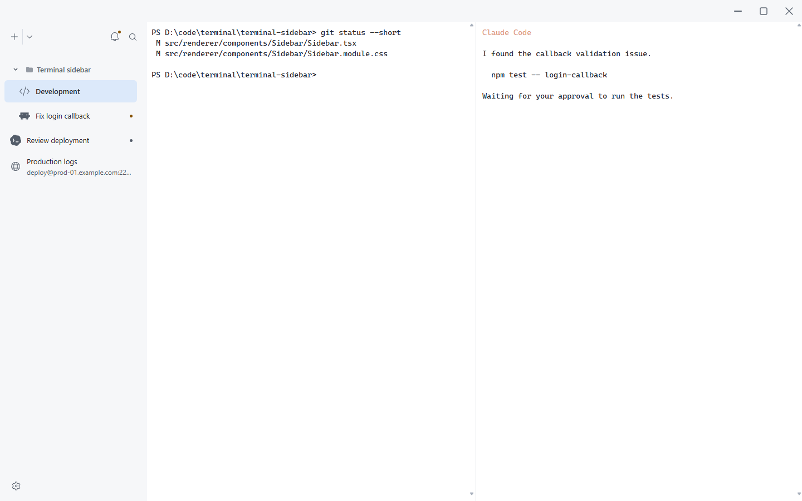
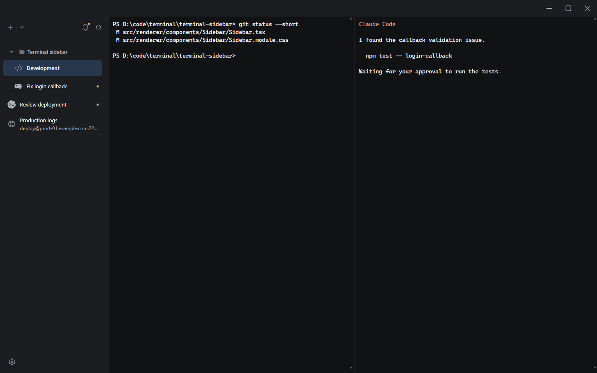

# 简洁工作界面交付记录

2026-11-03。依据用户确认的效果图及后续修订实施。

## 范围与提交

目标是让应用呈现为终端内容与一体的应用区域。侧栏和应用顶栏共享背景，终端不再带独立标题条、卡片描边或重复底栏。

不改变后端状态协议、会话进程生命周期、SSH 认证或 CLI 集成配置；此前暂停的 AI 会话恢复等工作不在本轮范围内。

1. `3a32bc7`：合并会话与命令查找；铃铛通知；迁移会话详情、性能和 SSH 监控入口；SSH 命令输入默认收起。
2. `c50d635`：移除终端顶栏、重复边框和状态标签；统一应用背景；普通会话保持安静，侧栏选中态标识当前会话。
3. 最后一批：补齐真实浏览器验证、SSH 输入焦点与草稿保留、侧栏收起后的键盘路径、使用说明和实际截图。

每批独立提交并验证。回滚按依赖逆序进行，保留现有持久化数据，无数据迁移。

## 最终行为

- 正常状态的侧栏仅常驻新建、创建菜单、通知和查找按钮，底部保留设置图标。
- 放大镜和 `Ctrl+Shift+P` 打开同一个临时界面，可查找命令、会话、路径、工具、远程目标以及上级集合名称。结果切换到目标工作区和窗格。
- 铃铛默认列出等待、错误以及未读的完成项；另可查看待处理或全部完成项。查看等待和错误不会将它们当作已解决。
- 通知支持键盘、Esc 和外部点击关闭。取消恢复触发按钮焦点，选择会话则聚焦对应终端。
- 普通会话只显示名称；同名会话补充目录，远程会话保留连接目标。详细状态、目录、Shell 和 PID 可按需查看。
- 移除活动网格、提醒光效、彩色工具底板和常驻状态文字，保留静态状态标记及完整无障碍描述。
- 终端只有内容和分屏分隔线。通过快捷键、统一查找或终端上下文菜单分屏、关闭与查看详情；右键会先确定所属窗格。
- 统一查找提供 Show session details、Show performance metrics、Show SSH monitor 和 Show SSH command input。
- SSH 命令输入默认收起；打开后获得输入焦点，Esc 收起并回到终端，再次打开保留草稿。原有命令历史和补全继续可用。
- 应用左上角常驻侧栏切换按钮，收起与展开使用同一个位置，支持鼠标及键盘操作。侧栏收起时，隐藏控件不再接收键盘焦点，顶栏同时提供查找按钮。

## 验证

- 前端全量测试：81 个文件，772 项通过。
- 类型检查通过。
- 代码注释检查与补丁空白检查通过。
- 最终 `tauri build --no-bundle` 通过，产物为 `D:\rust-cache\target\release\patty.exe`。
- 普通构建隔离检查通过：在 WebView 和 CLI 集成启动前拒绝测试配置覆盖，临时目录清理和重复清理均成功。
- 真实 Chromium 中的 React 组件和 xterm.js 验收通过。使用固定模拟传输，不创建真实 PTY 或 SSH 连接。
- 深浅色主题及 160 / 264 / 320px 侧栏均检查按钮边界和横向溢出。
- 已检查左右侧栏的通知与预览边界，通知及详情关闭后的焦点，以及会话、分屏、主题、快捷键改绑和 360px 窄窗口的操作。
- 浏览器验证应用快捷键不会向模拟终端传输写入字符。
- 实际截图已人工查看，README 中使用新的验收截图，保留旧图片文件。

## 实际截图

其他截图和逐尺寸记录位于 `output/workbench-visual/`：通知、会话详情、主题选择器、统一查找和 `verification.json`。该目录不提交。

## 验证边界

原生 WebView2 的桌面自动化调试连接仍是已有环境阻塞。本次浏览器验收不代表已通过真实 Windows 窗口拖拽、系统显示缩放、真实 SSH 或 CLI 生命周期验收。

本次没有重试旧的 USERPROFILE 重定向或不可清理的临时目录，也没有修改用户 CLI 配置。桌面构建与隔离检查通过，不将它们当作原生界面操作已验收。
