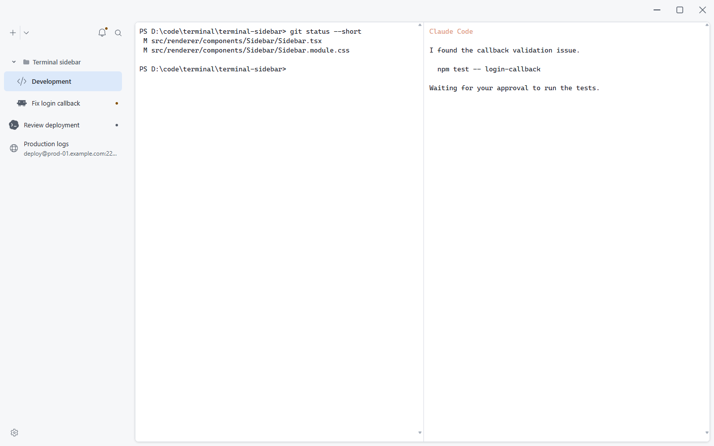
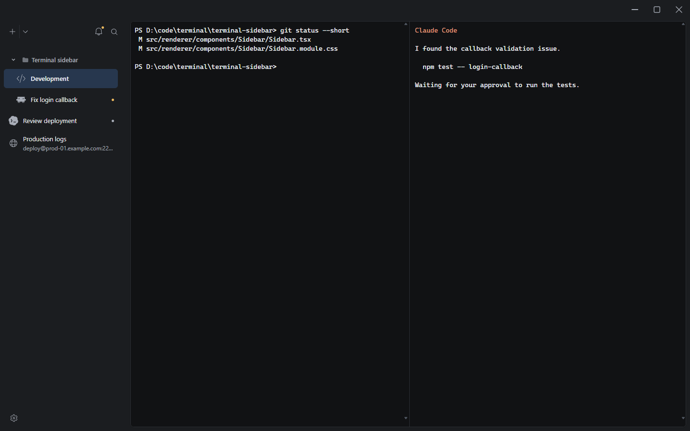

# Windows 圆角、层次与材质方案

2026-11-03。针对用户要求的终端圆角、内容层次和 Windows 应用材质进行调研。圆角与实色内容层先实施，原生窗口材质作为下一批独立交付。用户已确认采用 Windows 11 原生 Mica 与实色回退。

## 建议

顶栏和侧栏共同作为应用底层，整块终端作为连续的内容层。Windows 11 优先使用原生 Mica 作为底层；Windows 10、效果不可用或用户关闭效果时使用实色回退。终端正文保持不透明，避免桌面内容影响文字和 ANSI 颜色。

默认使用普通 Mica。Mica Alt 的壁纸着色更强，适合需要额外命令层或标签标题栏的结构；Patty 已经简化成两个主要区域，不需要借它增加新的视觉层级。

## 官方经验

| 问题 | 微软建议 | 对 Patty 的应用 |
|---|---|---|
| 内容层次 | 应用通常分为底层和内容层；用轮廓和适量投影表达高低关系 | 顶栏与侧栏保持一体；终端使用一个内容容器，不恢复每个分屏的卡片框 |
| 圆角 | Windows 指南给出的常见层级是 8px、4px 和相交直边的 0px | 整块终端外沿使用 8px；内部相交的分屏直线不逐个加圆角 |
| 长期背景 | Mica 是融合系统主题与桌面壁纸的动态不透明材质 | 用于应用底层，不能将它解释成整窗低透明度 |
| 临时界面 | Acrylic 适合临时菜单、浮层等；固定分隔内容的竖向区域建议用不透明背景 | 不默认给固定侧栏使用大面积 Acrylic，也不叠加多层磨砂 |
| 颜色 | 使用中性色承载结构，强调色用于必要交互和状态 | 底层保留低饱和度，终端背景沿用主题；不添加新的彩色渐变和品牌光效 |

依据：[Windows 层次](https://learn.microsoft.com/en-us/windows/apps/design/signature-experiences/layering)、[Windows 几何](https://learn.microsoft.com/en-us/windows/apps/design/signature-experiences/geometry)、[Mica](https://learn.microsoft.com/en-us/windows/apps/design/style/mica)、[Acrylic](https://learn.microsoft.com/en-us/windows/apps/design/style/acrylic)、[Windows 颜色](https://learn.microsoft.com/en-us/windows/apps/design/signature-experiences/color)。

## 本批内容层

- 整块内容区使用 8px 圆角，裁切内部终端背景；单个分屏不恢复标题条、圆角卡片或醒目描边。
- 上方留白 4px，其他外沿留白 8px，让圆角与内容轮廓能被看见。左右侧栏使用相同规则。
- 使用现有主题的细轮廓和 `0 1px 4px` 的低强度投影；不添加大面积模糊阴影。
- 终端整体背景不透明，分屏之间保留细分隔线。
- 应用外沿使用侧栏背景，保持顶栏、侧栏和留白的连续性。
- 高对比模式使用系统轮廓并取消投影。

这些尺寸是 Patty 的初始设计值，不是微软对终端界面的强制规格。浅深色主题与窄窗口截图需要实际验收。

## 颜色与透明度

| 区域 | 浅色方向 | 深色方向 | 透明度 |
|---|---|---|---|
| 顶栏、侧栏和外沿 | 低饱和度的浅灰；原生材质启用后接受少量壁纸染色 | 低饱和度的深灰；接受轻微壁纸染色 | Mica 原生合成，不设整个窗口的 alpha |
| 终端内容 | 沿用用户终端主题的浅色背景 | 沿用用户终端主题的深色背景 | 保持不透明 |
| 通知、命令查找和详情 | 清晰的浮层背景与轮廓 | 清晰的浮层背景与轮廓 | 第一版保持实色；Acrylic 留作单独评估 |

Mica 不存在一个通用的“最佳透明度百分比”。随意把根节点设为 80% 会连文字和控件一起淡化。给网页背景设置 alpha 也不等同于已经获得 Windows 原生材质。

第一批不重写内置和自定义主题的颜色。原生材质的色彩策略需要结合主题切换确认，不能用 CSS 值模拟壁纸染色后宣称接入了 Mica。

## 当前工程事实

- 主窗口通过 Rust `WebviewWindowBuilder` 创建，关闭系统装饰，使用实色启动背景；当前未启用透明窗口或原生背景效果。
- 已锁定 Tauri 2.11.5，依赖树包含 window-vibrancy 0.6.0。是否需要直接依赖该库，应优先由现有 Tauri 接口能力决定。
- Tauri 官方文档要求窗口以及网页相关底层允许透明，效果才能露出。其 Mica 支持限于 Windows 11。
- Tauri 也记录了 Acrylic 在部分 Windows 版本拖动和缩放时的性能问题。因此不建议把 Acrylic 当成 Windows 10 上的默认补偿方案。
- 现有原生 WebView2 自动化调试连接仍有环境阻塞。浏览器截图可验证内容圆角，不能证明原生 Mica 的材质、性能和系统回退正确。

依据：[Tauri 窗口效果](https://v2.tauri.app/reference/javascript/api/namespacewindow/#seteffects)、[Tauri 效果枚举](https://v2.tauri.app/reference/javascript/api/namespacewindow/#effect)、本地 `src-tauri/src/lib.rs` 主窗口创建与 `src-tauri/Cargo.lock`。

## 原生材质的 4+1 计划

### 目标

Windows 11 下只让应用底层使用原生 Mica。终端内容保持不透明。原生效果无法使用时仍有完整可读的实色界面。

### 非目标

不新增高透明桌面穿透、动态壁纸背景、整窗 opacity、Acrylic 侧栏、多层模糊或新的常驻控制。

### 影响模块

Rust 主窗口初始化、材质与主题的同步策略、前端根背景、外观设置及对应验证。优先复用现有 Tauri 能力，避免不必要的新依赖和宽泛窗口权限。

### 回滚

原生材质与内容圆角分开提交。回滚材质提交后仍保留本批的圆角和实色层次。启动阶段保留安全的实色背景，避免材质失败导致透明黑底或白闪。

### 分批提交与验收

1. 先用后端失败测试定义选择规则：支持的 Windows 11、不可用效果、非 Windows、系统关闭透明效果、强制高对比、用户选择纯色和未知主题数据。接入前核实哪些系统状态由当前 Tauri / DWM 路径自动处理，哪些必须自行监听；不直接套用 WinUI 的自动行为承诺。
2. 接入窗口原生背景和前端透明底层，主题切换同时更新材质明暗和实色回退。切换后不残留旧材质，也不使终端正文变透明。
3. 原生窗口验收：激活和失焦、最大化和还原、拖动和缩放、系统透明开关、高对比、不同主题和壁纸。检查启动闪烁和渲染资源占用，确认失败后回到实色。

这部分涉及窗口合成策略，有多条合理路线，依据仓库 AGENTS.md 的架构决策规则，在实施前确认。推荐选择“Windows 11 原生 Mica，其他环境实色回退”；备选是本轮仅完成实色层次，后续单独验收原生材质。

## 内容层验证

类型检查与真实浏览器工作台验收通过。已查看浅深色截图，窄侧栏、左右侧栏、通知、详情与键盘操作保持通过。材质尚待下一批原生接入。

